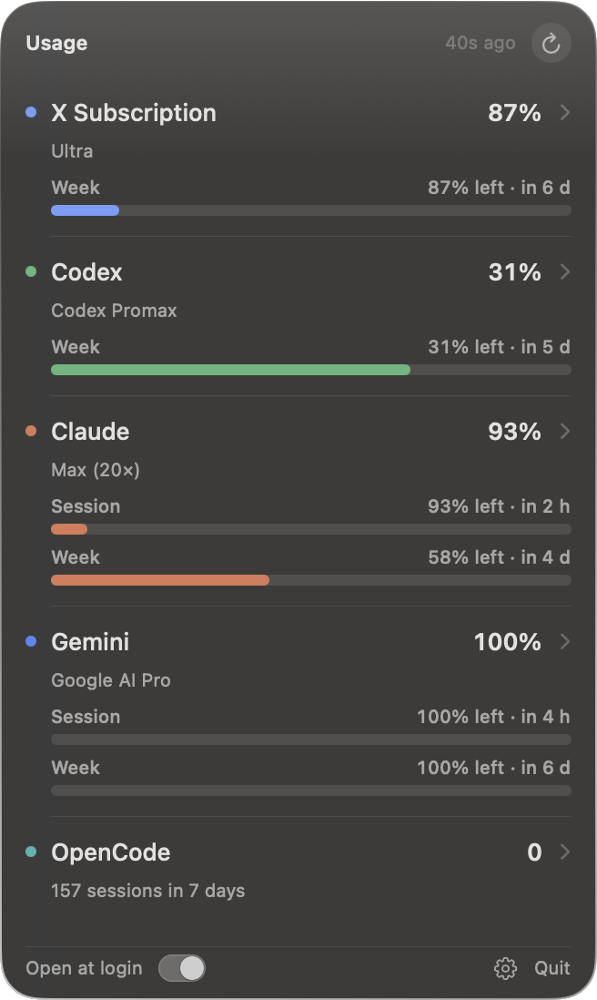
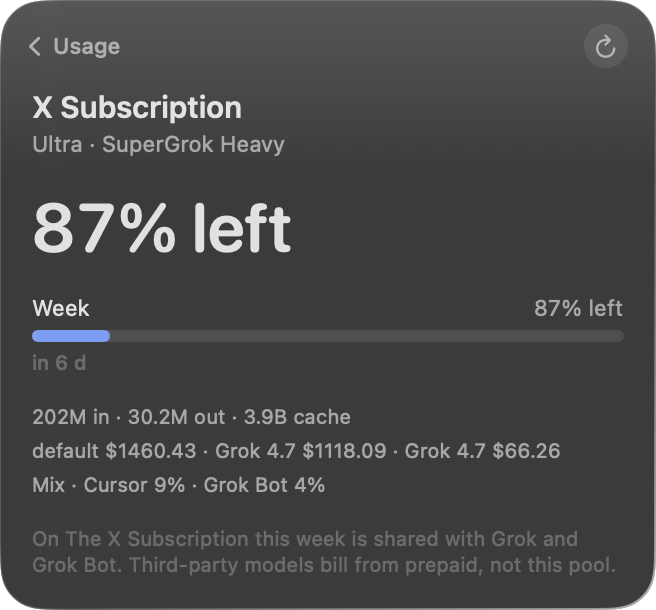

<p align="center">
  
</p>

# Uso

Menu bar app for macOS. It shows what is left on Grok, Grok Bot, Cursor, Codex, Claude, Gemini, and OpenCode. Only the services you use on this Mac appear.

The menu bar cycles through the accounts, about 3 seconds each. Claude shows the 5-hour window, then the week. On The X Subscription the week is one shared pool; on a legacy Cursor plan, Auto then included dollars. Click the item to open the panel. Click anywhere else, or press Escape, to hide it. Open a row for the full breakdown.

The panel opens with a short spring animation, staggered rows, a moving edge highlight, and animated meters. macOS Reduce Motion disables these effects. Escape returns from a detail to the list, then closes the panel; Command-R refreshes the usage.

<p align="center">
  
</p>

<p align="center">
  
</p>

Requires macOS 14 or later, on Apple silicon or Intel.

## Install

Paste this in Terminal:

```sh
curl -fsSL https://raw.githubusercontent.com/bujosa/uso/main/scripts/get.sh | bash
```

It downloads the latest release for your chip (Apple silicon or Intel), checks it against its SHA-256 checksum and code signature, installs `Uso.app` in `~/Applications` (or replaces the copy already in `/Applications`), and opens it. Run it again to update. You can [read the script](scripts/get.sh) first.

Uso is locally signed, not Apple-notarized. macOS asks for approval when a browser downloads an app like this, but not when `curl` downloads it, so the app opens right away.

Look in the menu bar. The label cycles through each account. The app does not show a Dock icon. Quit it from the panel.

### Manual download

Download the zip for your Mac from the [releases page](https://github.com/bujosa/uso/releases/latest): `apple-silicon` for M-series chips, `intel` for Intel processors. Apple menu > About This Mac shows which one you have.

1. Unzip the file. You get `Uso.app`.
2. Move `Uso.app` into Applications.
3. Open it. macOS says it can't check the app. Open System Settings > Privacy & Security, click Open Anyway, and confirm. On macOS 14 you can instead right-click `Uso.app`, choose Open, then Open again.

## Sign-in

Sign in with the Claude Code CLI. Uso rereads that live session for each refresh and does not log in, refresh the token, write the keychain, or save a copy of the credentials. A failed refresh keeps the last percentages on the row, labeled with the last successful reading time. Those old readings leave the menu bar rotation until the next successful refresh. A rejected or missing session clears the old account's numbers.

Cursor 3.27 and later seal the desktop sign-in so only Cursor can open it. Uso does not try. Run `cursor-agent login` once with the [Cursor CLI](https://cursor.com/cli), and Uso reads the CLI's session instead, without a password prompt. Older Cursor versions keep working from the desktop session.

For Grok Bot, open the Grok Bot app on this Mac once, and sign in to Cursor (or the Cursor CLI) with the same account. On The X Subscription, Grok Bot draws from the same weekly pool as Cursor and Grok. On a legacy Cursor plan, the bot still has its own weekly allowance. Uso uses Cursor's session; it does not decrypt Grok Bot's credential storage.

For Gemini, run `agy` and sign in with the Google account that has Google AI Pro or Ultra. Uso reads that session from the login keychain and does not write it back. A Google API key is a different path and is not this quota.

## From source

```sh
./scripts/install.sh
```

That builds a universal release binary (arm64 and x86_64), installs `~/Applications/Uso.app`, and opens it. `./scripts/package.sh` writes the signed universal app plus one signed zip and SHA-256 checksum per chip, `dist/Uso-1.3.0-macOS-apple-silicon.zip` and `dist/Uso-1.3.0-macOS-intel.zip`, without installing anything. It stops if either architecture is missing.

Run `swift test` for quota parsing, session rotation, failed refresh, rate-limit, plan metadata, Cursor session, source detection, and preference persistence regression tests. Run `swift build -c release --arch arm64 --arch x86_64` to check the release build. CI runs both, plus `swift format lint --strict` and a script check, on every pull request.

## What each row shows

- **X Subscription.** When Grok, Cursor, and Grok Bot report The X Subscription, the panel shows one week (the Cursor reading), plus Grok's mix and prepaid on that same row. Grok and Grok Bot stay in Settings; turn either on if you want the separate row. Legacy Cursor plans still show Grok, Grok Bot, and Cursor as their own quotas: Grok weekly credits plus product meters, Grok Bot's week or trial, Cursor Auto then included dollars.
- **Codex.** The weekly window is on the row. A shorter window, when the account has one, sits above it.
- **Claude.** Session and week are both on the row. A model week such as Fable, and the mix across Claude Code and the rest, are inside the row.
- **Gemini.** Session and week for the Google account signed in to Antigravity (`agy`). Extra model groups, when the account returns them, are inside the row.
- **OpenCode.** Local tokens for today, the last 7 days, and all time. This is sessions on this Mac, not a plan quota. An OpenCode Go key adds the official quota.

Bars fill as usage goes up. Red means 90% or more used. Orange means 75% or more. The number on the row is what is left.

The panel refreshes when you open it, and again every 3 minutes. The refresh button forces a new read. If Claude returns HTTP 429, Uso waits for `Retry-After` (or 3 minutes when no valid delay is provided), including when the refresh button is pressed.

## Settings

Click the gear in the panel, or press Command-comma, to open Settings. Accounts & plans lists every supported source, its detected plan, and its connection state. Free plans and local OpenCode activity are labeled separately. Claude Max shows the 5× or 20× tier when the session reports it; Grok Bot also shows the Cursor tier returned by its account. Gemini shows Google AI Pro or Ultra from the Google One paid tier when Antigravity reports it, otherwise Free.

A source appears once Uso finds a session for it on this Mac. One that needs attention, such as an expired session, stays visible with what to do. Sources you don't use stay out of the panel and menu bar, so there is nothing to set up. Grok Bot needs the Grok Bot app on this Mac. Gemini needs an Antigravity CLI (`agy`) sign-in. OpenCode without a Go key needs local activity in the last 30 days.

Each source has independent Panel and Menu bar switches. A switch you change overrides detection and is saved on this Mac. Every source still appears in Settings, so you can show it again. Show detected only clears your overrides; Check now reruns detection. Manage account opens the provider's account website.

General has open-at-login and opening-animation controls, plus Show all sources to show every source, found or not. macOS Reduce Motion takes priority over the animation switch. Open at login uses the macOS login item for this app.

## Where the numbers come from

Uso reads the session each tool already saved on this Mac. It does not ask you to paste an API key.

| Service | Local session | Usage endpoint |
| --- | --- | --- |
| Grok | `~/.grok/auth.json` | Grok CLI billing |
| Grok Bot | Same Cursor session as below, same account as Grok Bot | Cursor dashboard `GetSandUsageStatus` |
| Cursor | Cursor's local database, or keychain item `cursor-access-token` from the Cursor CLI | Cursor dashboard |
| Codex | `~/.codex/auth.json` | Codex usage |
| Claude | Login keychain item `Claude Code-credentials` | Claude OAuth usage |
| Gemini | Keychain item `gemini` / `antigravity` from `agy` | Antigravity quota summary |
| OpenCode | `opencode.db` on this Mac | OpenCode Go, only if that key is present |

Tokens stay in memory for the request. Uso does not write them to a log or to its own database.

Each background Keychain read stops waiting after 3 seconds. If macOS cannot return the session in time, Uso shows a recoverable error instead of leaving the refresh stuck. A manual permission request may wait up to 30 seconds.

These usage endpoints are internal APIs and can change. On The X Subscription, Grok, Cursor, and Grok Bot share one weekly included pool; see [The X Subscription](https://cursor.com/help/the-x-subscription/overview) and [Grok Bot plans](https://cursor.com/help/grok-bot/plans). On a legacy Cursor plan, Grok Bot's allowance is still metered on the Cursor account even when a linked SuperGrok plan funds it. Claude accepts both the newer `limits` array and the older per-window fields, including model limits. Malformed quota values produce a refresh error rather than an assumed 100% remaining.

## License

MIT. See [LICENSE](LICENSE).
